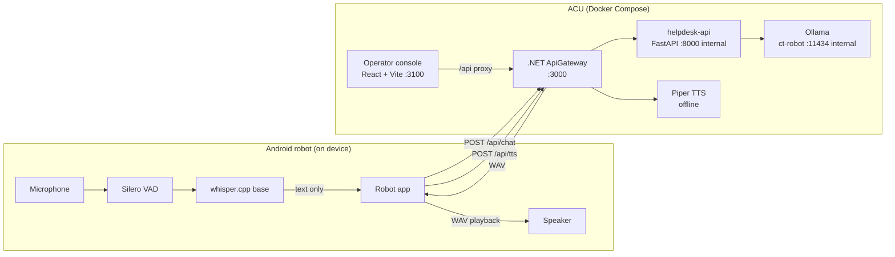

# ACU — Smart Patient Robotic Companion

ACU (Alfred Control Unit) is the operator console, API gateway, and Android
robot client for a hospital CT waiting area. The robot listens locally, turns
speech into text on the device, and sends only text to the ACU. The ACU answers
through a local Qwen model, synthesizes speech offline with Piper, and the robot
plays the answer and resumes listening.

The operator UI is a **real-time monitoring console**: registered robots,
pending approval requests, live workflow progress, and ACU settings. The
patient-facing preview page was intentionally removed from the operator
frontend; patient interaction happens on the robot itself.

This repository was built for the *C1 Smart Patient Robotic Companion*
hackathon challenge (Erlangen, October 2026).

## Reproducibility

The repository is functionally reproducible from a clean clone. See
[`docs/REPRODUCIBILITY.md`](docs/REPRODUCIBILITY.md) for the pinned revision,
the rebuild procedure, and the verification log. The complete dependency
inventory is in [`docs/DEPENDENCIES.md`](docs/DEPENDENCIES.md), and the
third-party licence review checklist is in
[`docs/THIRD_PARTY.md`](docs/THIRD_PARTY.md).

It is **not bit-for-bit reproducible**: container base images and Ollama model
tags are not digest-pinned, NuGet transitives resolve at restore time, and
Android Gradle/Maven dependencies resolve from remote repositories. The source,
prompts, npm lockfiles, and Python lockfiles are pinned and committed.

## Architecture



Only port `3000` (gateway) and `3100` (operator UI) are published. The model
adapter and Ollama stay on the internal Compose network.

## Repository layout

| Path | Purpose |
| --- | --- |
| `Source/acu/ApiGateway/` | .NET 10 API gateway: device registry, approval, workflows, conversations, TTS |
| `Source/acu/BE/AcuStorage/` | Shared storage library used by the gateway |
| `Source/acu/BE/MdnsAdvertiser/` | Optional mDNS advertiser (`lan` profile) |
| `Source/acu/ACU.FE/` | React + TypeScript operator console (PWA) |
| `Source/acu/Robot.Pwa.App/` | Expo/React Native Android robot client with local VAD + Whisper |
| `Source/acu/docker-compose.yml` | ACU-side deployment |
| `helpdesk_api/` | Internal text-only FastAPI → Ollama adapter |
| `ai_engine/` | Retrieval experiment and evaluation questions (not a service) |
| `acu_standin/` | Python stand-in gateway for robot demos without Docker or .NET |
| `eval/` | Scripted patient-question evaluations against a running gateway |
| `data/siemens_ct_guide.txt` | Source material used by the stand-in and prompts |
| `Doc/` | Challenge statement and organizer API guide (PDF) |

## Dependencies at a glance

| Area | Direct dependencies | Lock / pin |
| --- | --- | --- |
| .NET gateway | 4 NuGet packages (`Swashbuckle`, `Configuration.Abstractions`, `Configuration.Binder`, `Makaretu.Dns.Multicast`) | Direct versions in `.csproj`; no NuGet lockfile |
| `helpdesk-api` | FastAPI, Uvicorn, Requests, Pydantic | `helpdesk_api/requirements.lock` (18 packages, Python 3.12) |
| `acu_standin` | FastAPI, Uvicorn, Requests, Pydantic | `acu_standin/requirements.lock` (19 packages, Python 3.10+) |
| `ai_engine` | FastEmbed, NumPy | `ai_engine/requirements.lock` (34 packages, Python 3.10+) |
| Piper TTS | `piper-tts` | `Source/acu/ApiGateway/Tts/requirements-piper.lock` (7 packages) |
| Frontend | 4 runtime + 11 dev npm packages | `ACU.FE/package-lock.json` (165 entries) |
| Robot app | 19 runtime + 6 dev npm packages | `Robot.Pwa.App/package-lock.json` (662 entries) |
| Models | Whisper base, Silero VAD, 3 Piper voices, Qwen 2.5 1.5B, `ct-robot` | Size + SHA-256/MD5 checks, or Ollama registry |

The full version table, container images, toolchain matrix, and update
procedure are in [`docs/DEPENDENCIES.md`](docs/DEPENDENCIES.md).

## Quick start (full stack)

Prerequisites: Docker Engine/Desktop with Compose v2, about 8 GB free disk for
the AI profile, and network access on the first run.

```bash
cd Source/acu
docker compose --profile ai up -d --build
```

What happens on the first start:

1. `backend` and `frontend` images are built.
2. `piper-model-init` downloads and verifies three Piper voices
   (`en_US-lessac-medium`, `de_DE-thorsten-medium`, `zh_CN-huayan-medium`)
   into the `piper-models` volume.
3. With the `ai` profile, `ollama` starts and `ollama-model-init` creates the
   `ct-robot` model from `Source/acu/Modelfile.txt`, pulling `qwen2.5:1.5b`
   when it is absent.
4. `helpdesk-api` starts after the model exists.

Open:

- Operator UI: <http://localhost:3100>
- Swagger UI: <http://localhost:3000/docs> (JSON: `/swagger/v1/swagger.json`)
- Health: <http://localhost:3000/api/health>

Verify:

```bash
docker compose --profile ai ps
curl -fsS http://localhost:3000/api/health
curl -fsS -o /dev/null -w 'UI HTTP %{http_code}\n' http://localhost:3100/
```

Without the `ai` profile the operator console, device approval, and workflows
still work, but `/api/chat` returns `503` because no model adapter is running:

```bash
docker compose up -d --build
```

After editing `Modelfile.txt`, recreate only the model initializer:

```bash
docker compose --profile ai up -d --force-recreate ollama-model-init
```

Stop everything (data volumes are kept):

```bash
docker compose --profile ai stop
```

## Robot app

Requirements: Node.js 22.20+ and npm, Android Studio with JDK 17 and the
Android SDK, a device or emulator with a microphone, and a reachable ACU.

```bash
cd Source/acu/Robot.Pwa.App
npm ci
npm run models:prepare     # pinned Whisper + Silero VAD assets, verified by SHA-256
npm run models:check
npm run typecheck
npm run test:config
npm run test:device
npm run test:transcript
npm run test:conversation
npm run build:apk          # dist/acu-robot-development.apk (debug-signed)
```

Use `http://10.0.2.2:3000` from the Android emulator, or the ACU host's LAN
address from a physical robot. Model binaries and the APK are intentionally
ignored by Git. See `Source/acu/Robot.Pwa.App/README.md` for the full runtime
flow and native module details.

## Local development without Docker

Backend (requires the .NET 10 SDK):

```bash
dotnet run --project Source/acu/ApiGateway/ApiGateway.csproj
```

Frontend (Vite proxies `/api` to `http://localhost:3000`):

```bash
cd Source/acu/ACU.FE
npm ci
npm run dev
```

Model adapter (requires Python 3.12 and a running Ollama):

```bash
cd helpdesk_api
python -m pip install --requirement requirements.lock
OLLAMA_BASE_URL=http://localhost:11434 OLLAMA_MODEL=ct-robot \
  uvicorn main:app --host 0.0.0.0 --port 8000
```

For the no-Docker demo path used with the robot, install the pinned stand-in
dependencies and run the gateway:

```bash
python3 -m pip install --requirement acu_standin/requirements.lock
python3 acu_standin/standin_gateway.py     # serves :3000 on this laptop
```

## Configuration

The gateway reads `ApiGateway/appsettings.json` and Compose environment
overrides. The most important settings:

| Setting | Default (container) | Meaning |
| --- | --- | --- |
| `DataPath` | `/data/devices.json` | Registered devices / approvals |
| `WorkflowDataPath` | `/data/workflows.json` | Operator workflow definitions |
| `RobotWorkflowDataPath` | `/data/robot-workflows.json` | Robot-specific workflow assignments |
| `AcuSettingsDataPath` | `/data/acu-settings.json` | ACU-wide robot language setting |
| `Conversation__EnableDevelopmentResponses` | `false` | Never return a fake patient answer in Docker |
| `Conversation__SessionIdleTimeoutMinutes` | `5` | In-memory conversation expiry |
| `Conversation__MaxTurns` | `6` | Bounded history sent to the model |
| `Helpdesk__Enabled` | `true` in Compose | Use the internal model adapter |
| `Helpdesk__BaseUrl` | `http://helpdesk-api:8000` | Internal adapter address |
| `Tts__Provider` | `Piper` | `Piper` (neural) or `Espeak` (fallback) |
| `Tts__ModelDirectory` | `/models` | Piper voice volume |
| `Tts__LengthScale` | `1.0` | Speaking-rate control |

`appsettings.Development.json` enables clearly marked mock answers only for
direct `dotnet run` development without the adapter. Docker Compose keeps mock
answers disabled so a missing model produces `503`, never a pretend medical
answer.

## Tests and verification

All commands below are safe to run locally; the counts are the expected result
for this revision.

| Area | Command | Expected |
| --- | --- | --- |
| Frontend unit tests | `cd Source/acu/ACU.FE && npm test` | 49 tests in 11 files pass |
| Frontend production build | `npm run build` | `tsc -b` + Vite build succeed |
| Robot type check | `cd Source/acu/Robot.Pwa.App && npm run typecheck` | no errors |
| Robot unit tests | `npm run test:config && npm run test:device && npm run test:transcript && npm run test:conversation` | 11 tests pass |
| Model asset integrity | `npm run models:check` | all pinned assets valid |
| helpdesk adapter | see command below | 4 unittest tests pass |
| Backend compile | `cd Source/acu && docker compose build backend` | image builds |
| Compose syntax | `docker compose --profile ai config --quiet` | exits 0 |
| Python scripts | `python3 -m py_compile acu_standin/*.py eval/*.py ai_engine/test_embed.py` | exits 0 |

helpdesk tests inside the pinned container:

```bash
cd Source/acu
docker compose --profile ai build helpdesk-api
docker compose --profile ai run --rm --no-deps \
  -v "$PWD/../../helpdesk_api:/app" helpdesk-api \
  python -m unittest discover -s tests -v
```

Python services install their fully pinned `requirements.lock` files; the
stand-in, evaluation, and retrieval commands are in
[`docs/REPRODUCIBILITY.md`](docs/REPRODUCIBILITY.md). Frontend end-to-end tests
are optional and currently Windows-oriented; see
`Source/acu/ACU.FE/README.md` and the known limitations below.

## Documentation

- [`Source/acu/README.md`](Source/acu/README.md) — ACU solution, Compose
  profiles, local development, ports, and configuration.
- [`Source/acu/CONVERSATION_PIPELINE.md`](Source/acu/CONVERSATION_PIPELINE.md) —
  conversation, TTS, privacy, and API contracts.
- [`Source/acu/ACU.FE/README.md`](Source/acu/ACU.FE/README.md) — operator UI.
- [`Source/acu/Robot.Pwa.App/README.md`](Source/acu/Robot.Pwa.App/README.md) —
  Android robot client.
- [`helpdesk_api/README.md`](helpdesk_api/README.md) and
  [`helpdesk_api/API.md`](helpdesk_api/API.md) — internal model adapter.
- [`ai_engine/README.md`](ai_engine/README.md) — retrieval experiment.
- [`acu_standin/README.md`](acu_standin/README.md) — no-Docker demo gateway.
- [`eval/README.md`](eval/README.md) — evaluation procedure and recordings.
- [`docs/REPRODUCIBILITY.md`](docs/REPRODUCIBILITY.md) — pinned versions,
  step-by-step rebuild, checksums, storage expectations, and verification log.
- [`docs/DEPENDENCIES.md`](docs/DEPENDENCIES.md) — complete dependency and
  toolchain inventory, including transitive counts and update commands.
- [`docs/SECURITY.md`](docs/SECURITY.md) — trust boundaries, data handling,
  signing keys, and hardening checklist.
- [`docs/THIRD_PARTY.md`](docs/THIRD_PARTY.md) — third-party licence review
  checklist.
- [`docs/CHANGELOG.md`](docs/CHANGELOG.md) — final demo revision changes and
  verification results.

## Safety and privacy

- Raw microphone audio stays on the robot; only recognized text reaches the ACU.
- Conversation history is in memory, bounded, resettable, and expires after five
  idle minutes.
- Generated WAV audio is streamed and not persisted by the gateway; the robot
  deletes its temporary file after playback.
- The model prompt forbids diagnosis, patient-specific advice, medication
  instructions, invented logistics, and safety guarantees. Clinical questions
  are routed to radiology staff.
- The ACU is intended for a trusted hospital LAN/VPN. Device ID + MAC checks are
  application-state checks, not authentication.
- The checked-in Android key is for debug builds only.

## Known limitations

- The `ai` profile (Ollama image + Qwen 1.5B + Piper voices) is a workstation
  integration setup. It has not been shown to fit the challenge's 4 GB target
  storage budget.
- The first model answer after a cold start is slow because Ollama loads the
  model; subsequent answers are fast while it stays loaded.
- `ACU.FE` Playwright E2E uses a PowerShell gateway bootstrap and the live
  workflow spec expects a `RobotSimulator` project that is not part of this
  repository snapshot. Unit tests and the production build are the supported
  verification path.
- The operator UI intentionally has no patient preview page. Patient interaction
  is on the robot screen.
- Managed .NET and Python strings cannot guarantee forensic RAM erasure; the
  guarantee is no application-level persistence and prompt reference release.
- Rebuilds are functional, not bit-for-bit: container base images, NuGet
  transitives, the Ollama base-model tag, and Android Maven/Gradle dependencies
  are not digest-locked. See
  [`docs/REPRODUCIBILITY.md`](docs/REPRODUCIBILITY.md#13-known-reproducibility-gaps).
- The `ai_engine` experiment requires Python 3.10+ and pins NumPy 2.2.6; its
  FastEmbed model is downloaded from Hugging Face without a pinned revision.
- `npm audit` reports frontend and robot dependency advisories (no critical
  after removing unused Swagger UI React); review them before a production
  release. See [`docs/SECURITY.md`](docs/SECURITY.md#dependency-advisories-2026-10-26-snapshot).
- Third-party licences (Piper voices, eSpeak NG, Qwen model, Whisper, Silero,
  fonts) must be reviewed before product distribution; see
  [`docs/THIRD_PARTY.md`](docs/THIRD_PARTY.md).
